# Screenshot gallery

Fifteen actual application captures. All provider/client content, ratings, testimonials, counts and amounts are illustrative. These are product demonstrations, not customer or revenue evidence.

Twelve captures are from the local application on 15 October 2026. Three are earlier development captures, labelled below. No fresh booking or payment was submitted.

[Product overview](../README.md) · [Demo providers](demo-profiles.md) · [Feature status](features.md) · [Provenance and rights](rights-and-provenance.md)

## Provider profiles

Coaching profile

*Current local application. 1280 × 720.*

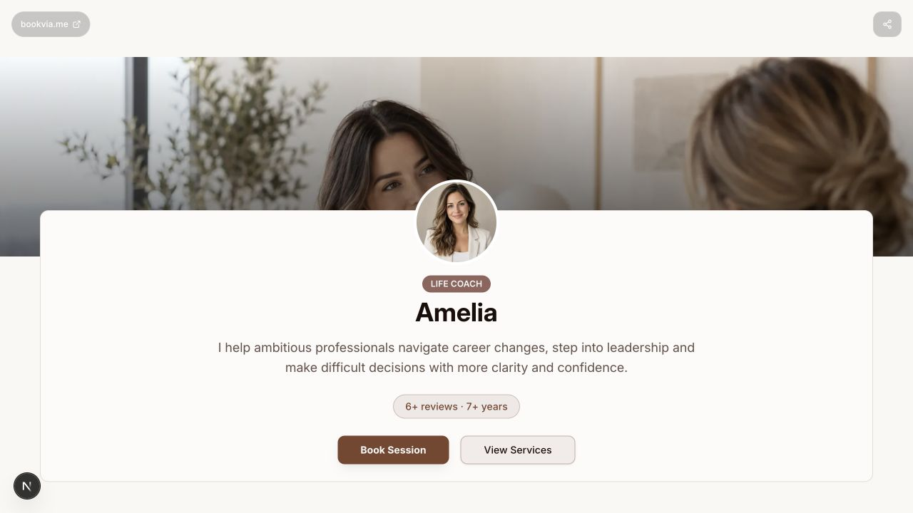

Coaching profile on mobile

*Current local application. 390 × 844.*

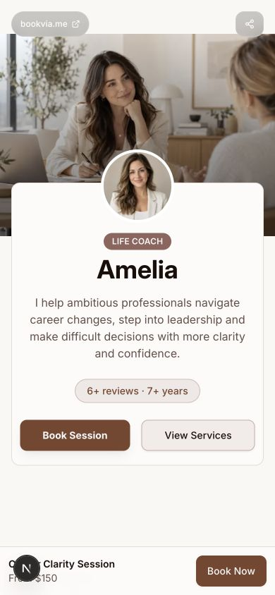

Fitness profile

*Current local application. 1280 × 720.*

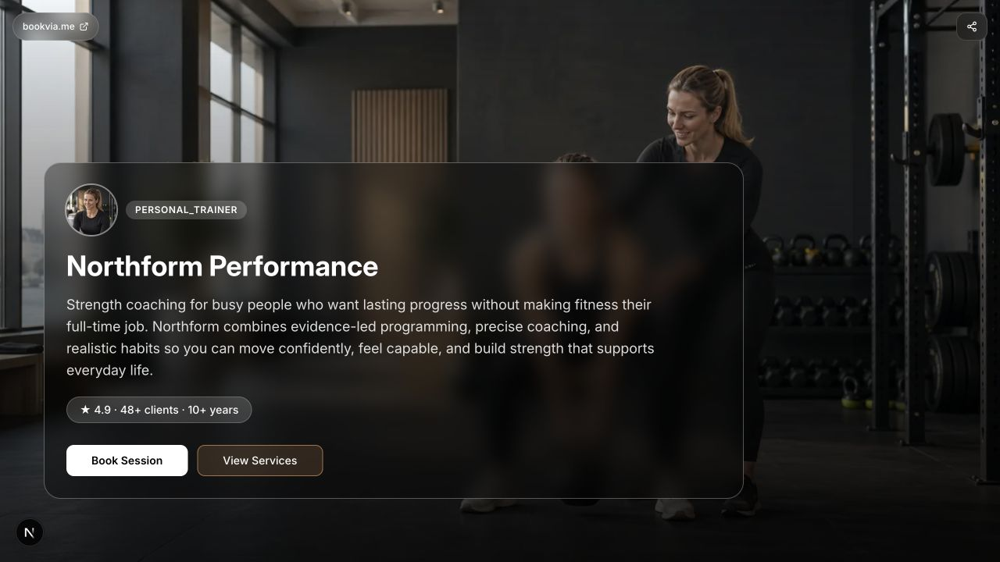

Fitness profile on mobile

*Current local application. 390 × 844.*

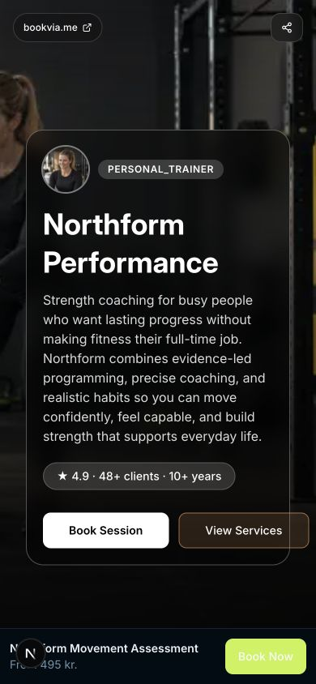

## Service presentation

Coaching catalogue and booking widget

*Current local application. 1280 × 720.*

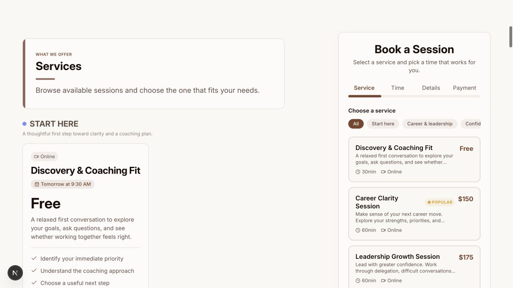

Coaching catalogue on mobile

*Current local application. 390 × 844.*

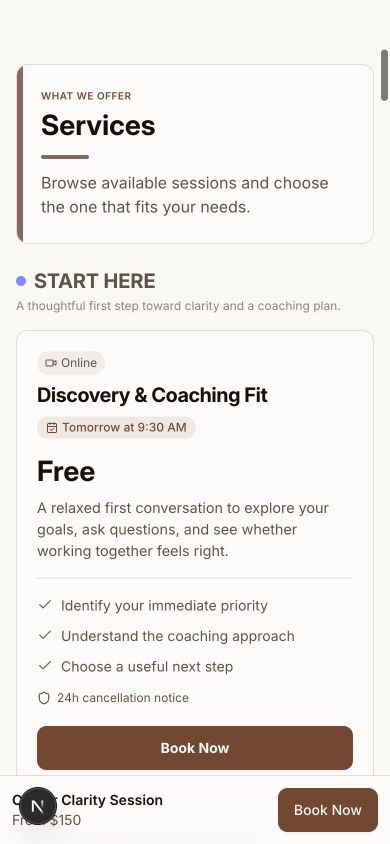

Fitness service card

*Current local application. 1280 × 720.*

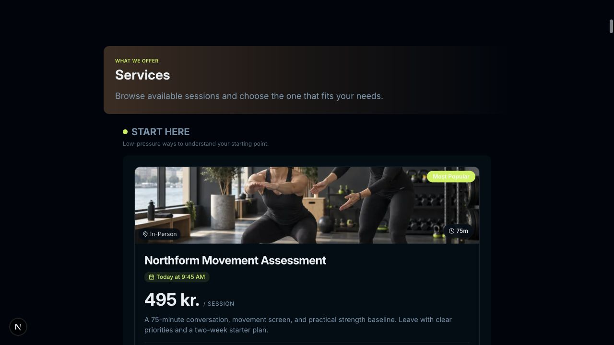

## Booking journey

A future date and available times

*Current local application. 1280 × 720.*

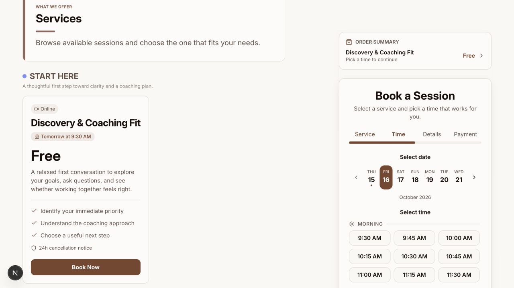

Empty booking details form

*Current local application. 1280 × 720.*

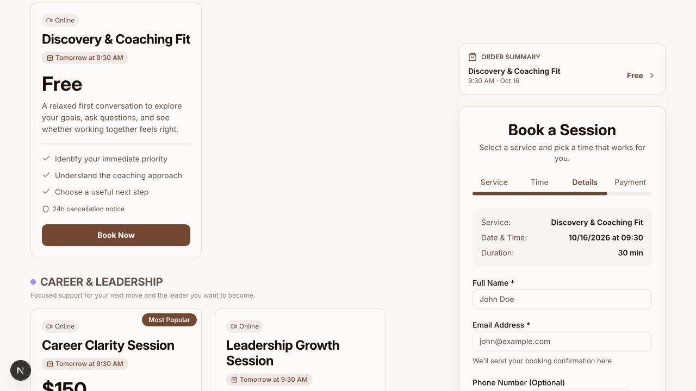

Booking service selection on mobile

*Current local application. 390 × 844.*

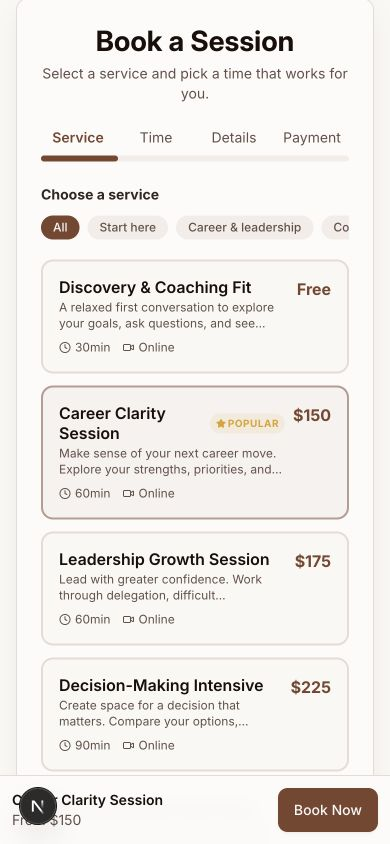

## Provider content

The testimonials are fictional text used to demonstrate layout. They are not endorsements or actual outcomes.

Expanded FAQ

*Current local application. 1280 × 720.*

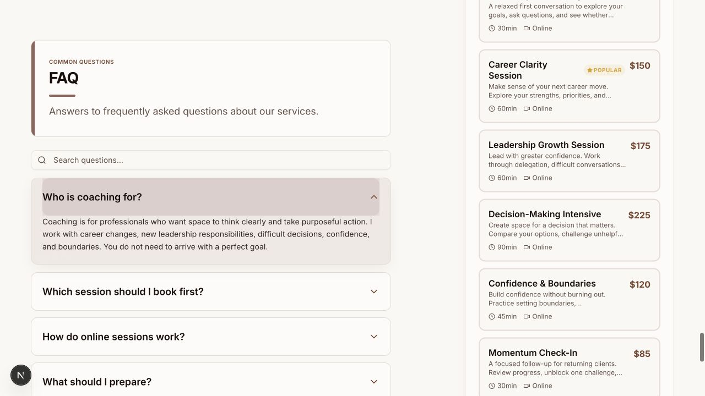

Fictional testimonials on mobile

*Current local application. 390 × 844.*

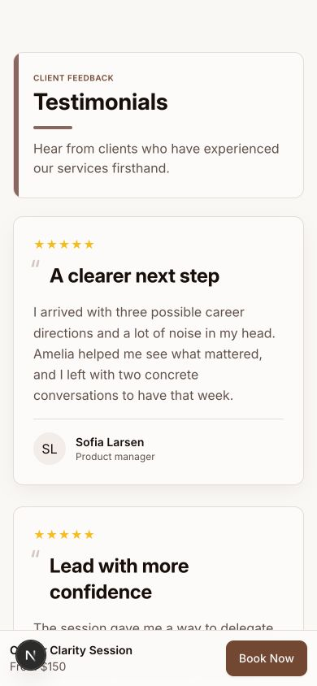

## Earlier onboarding views

Prior service-setup UI. Pricing-mode controls in this capture do not establish that every mode is supported end to end.

Service setup with a live preview

*Earlier development capture. 1280 × 1282.*

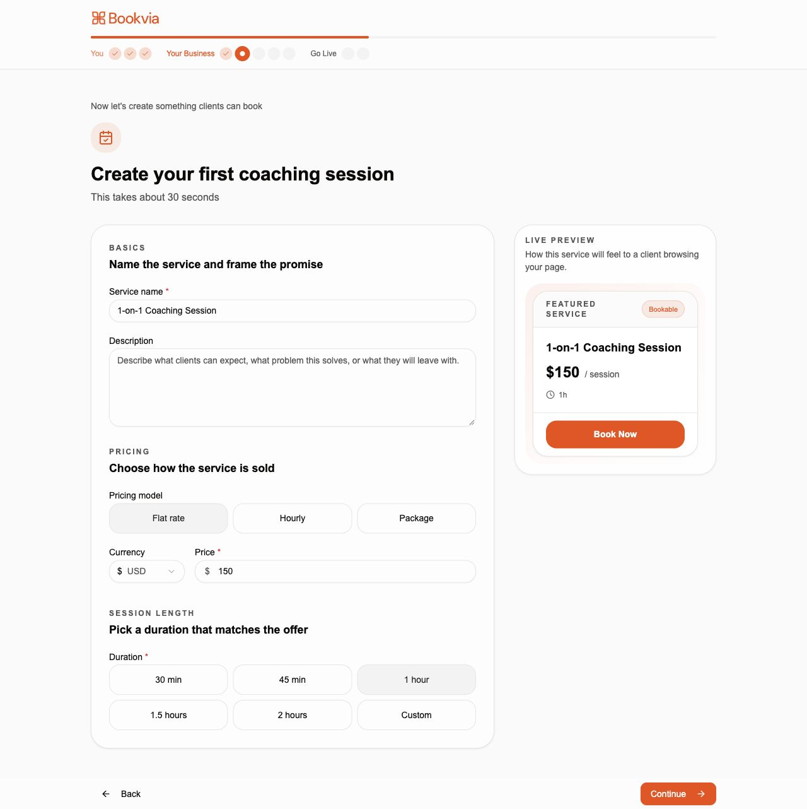

Service setup on mobile

*Earlier development capture. 390 × 1703.*

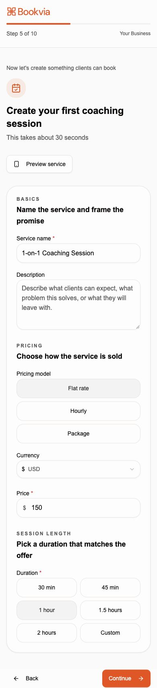

## Earlier calendar component verification

Prior component verification with seeded fictional appointments. This is not a fresh authenticated dashboard or live customer calendar.

Synthetic calendar component verification

*Earlier development capture. 1280 × 1327.*

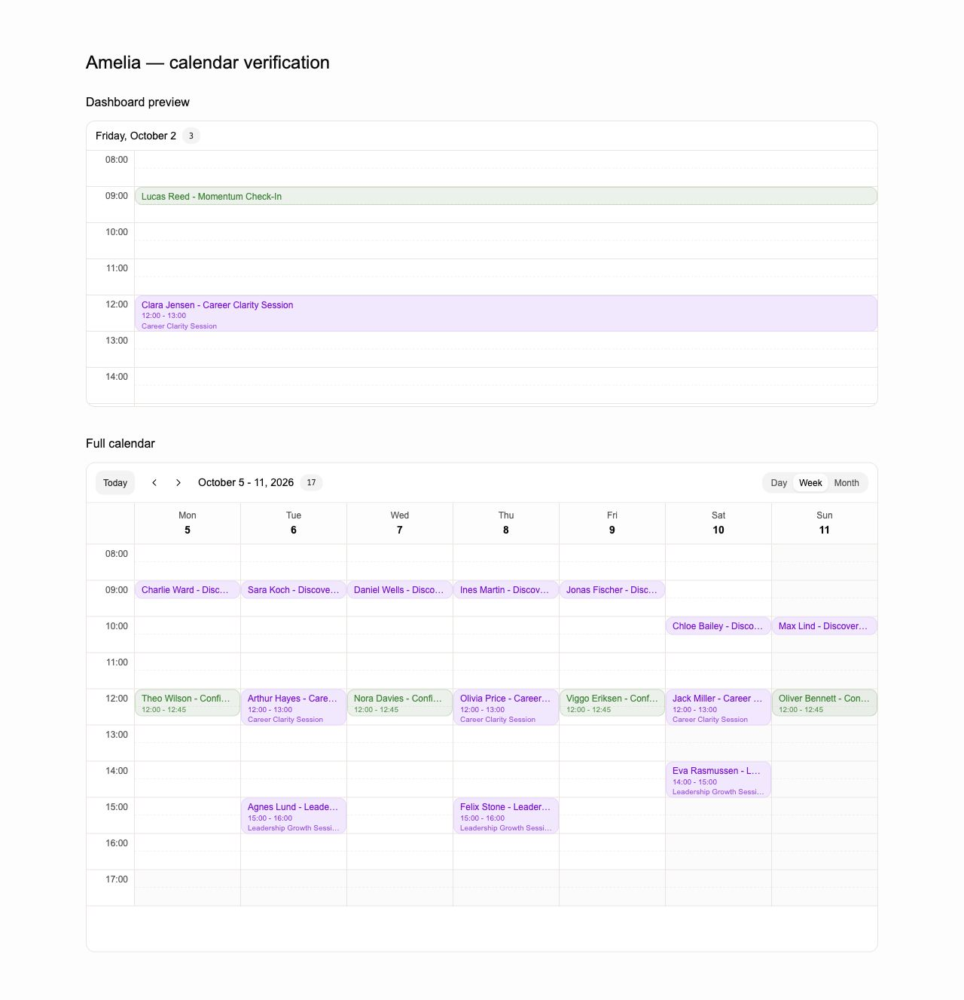

