# Provider workspace

Amelia’s authenticated demo workspace shows the operational side of Bookvia: a provider can review the day, inspect appointments and client history, and configure the service offering. These are actual local application captures from 15 October 2026 at 1440 × 1000.

**All people, appointments, amounts and performance figures are demonstration data.** They do not establish commercial activity. These captures verify rendered screens and navigation, not every action exposed by the interface.

[Product overview](../README.md) · [Public-page gallery](gallery.md) · [Feature status](features.md)

## Running the day

Daily dashboard

A daily appointment view, quick actions and a seven-day revenue summary bring the provider’s immediate work together.

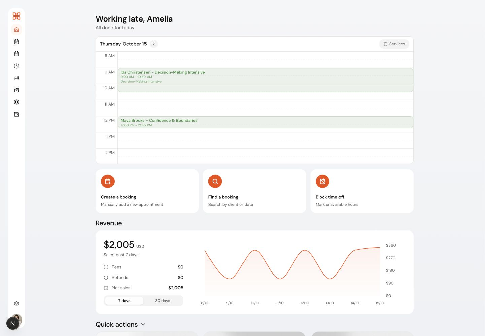

Weekly calendar

Colour-coded sessions show the working week and overlapping time commitments.

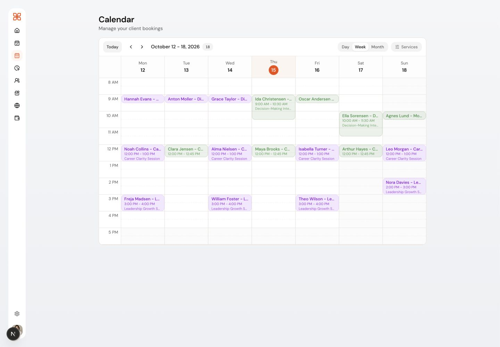

Monthly calendar

The month view gives a broader view of appointment density and service mix.

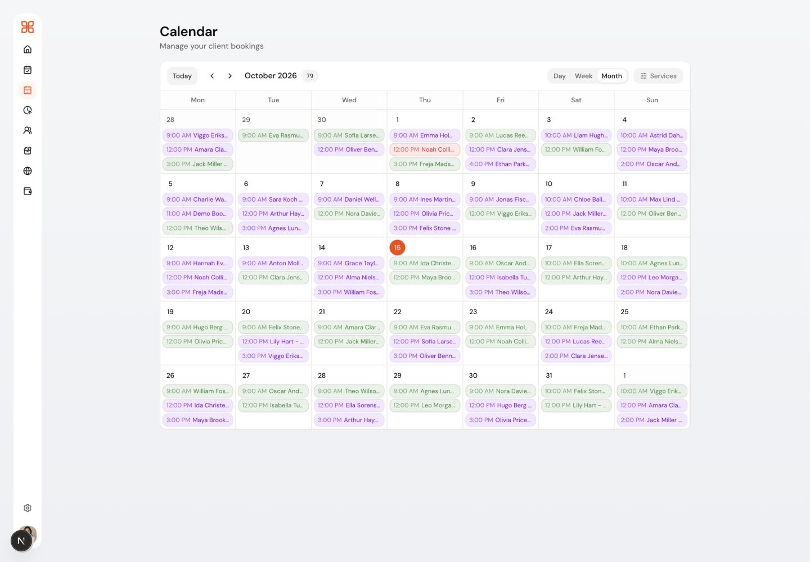

Upcoming bookings

A chronological list groups upcoming appointments and shows the associated service and status.

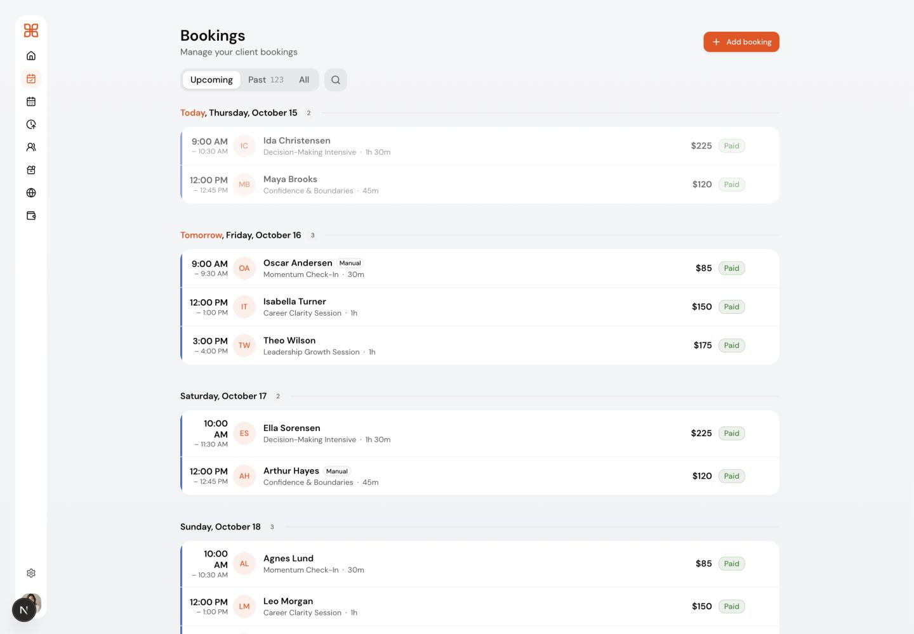

## Clients and services

Client directory

The client list combines contact details, booking counts and summary metrics. Visible contacts are fictional demo records.

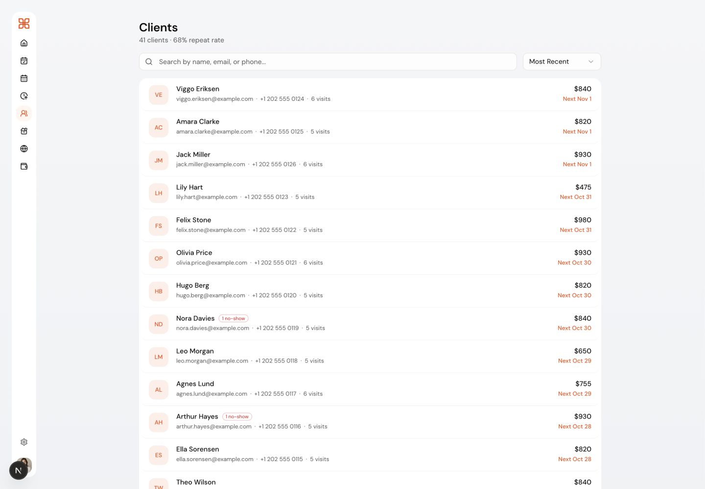

Client profile

A client record brings together illustrative spend, booking frequency, contact information and notes.

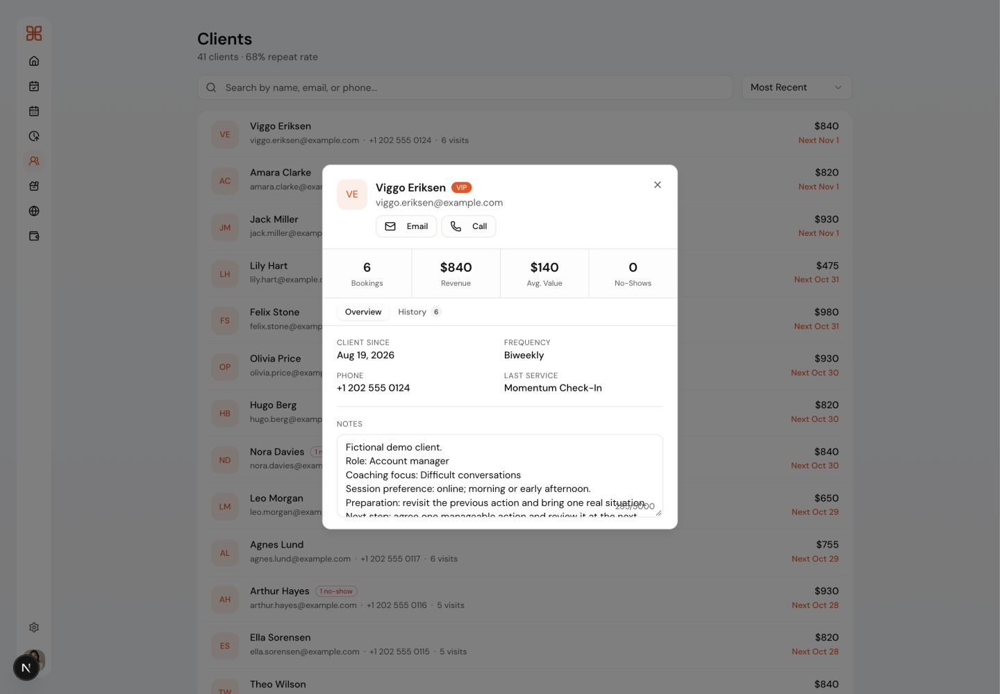

Client booking history

The history view connects the client to recorded sessions, dates and amounts.

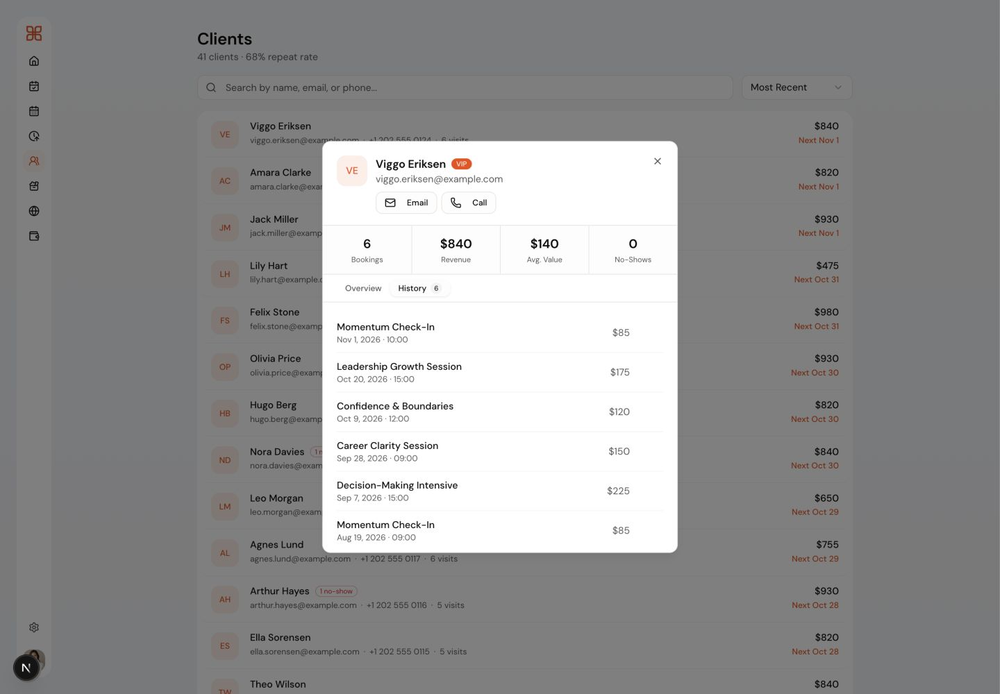

Service catalogue management

Six coaching offers show the configured service mix, prices and booking counts.

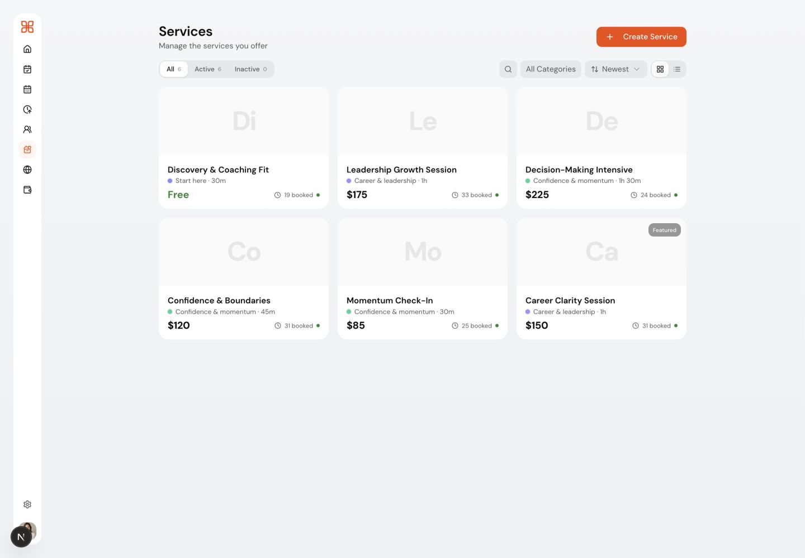

Service configuration

The edit dialog exposes the description, category, duration, price and delivery settings. It was inspected and cancelled without saving changes.

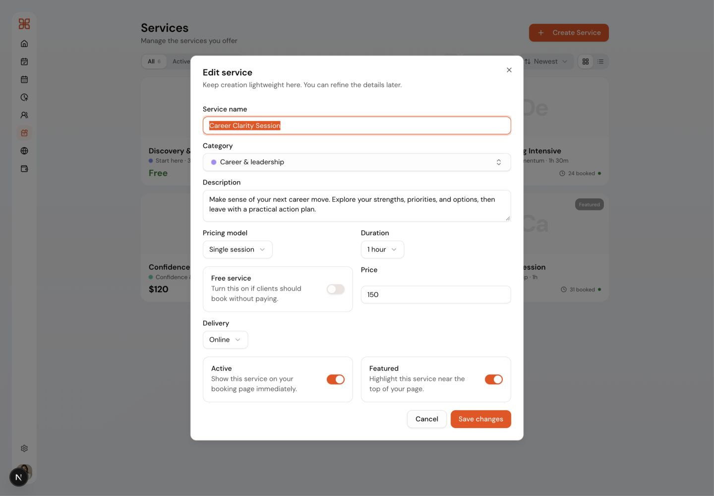

Availability and booking window

Working hours, time off and the advance booking window are presented together. No settings were changed.

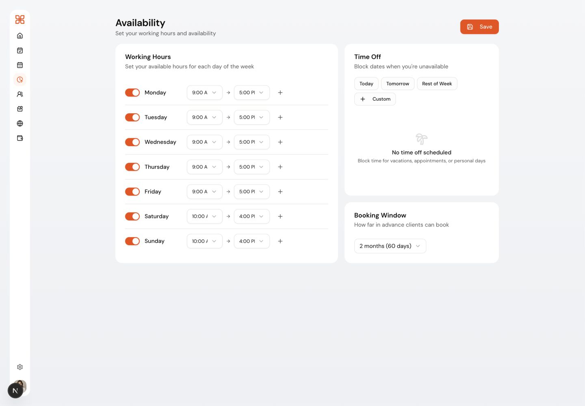

## Payment visibility

Payment records

The transaction list renders seeded amounts and status labels. Stripe is not connected for this demo account; “Paid” labels do not establish real charges or payouts.

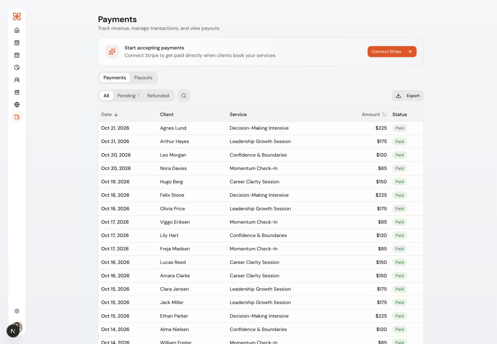

## Page editor development previews

The editor currently reports a save failure in this local environment. These views document the available controls and preview only; resolving that failure and verifying persistence and publishing remain release work.

Page editor: design preview

The design panel sits beside the provider-page preview. This development session showed “Save failed”; save and publish behaviour were not verified.

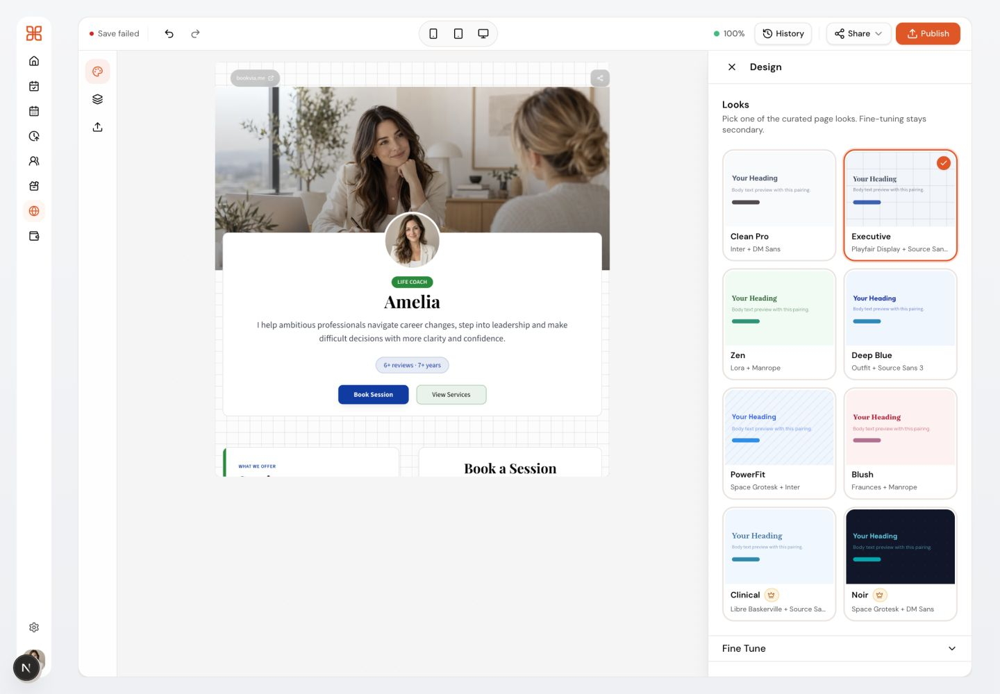

Page editor: content controls

Section visibility and ordering controls are visible beside the page preview. The same save failure is visible; no content toggles or publish action were used.

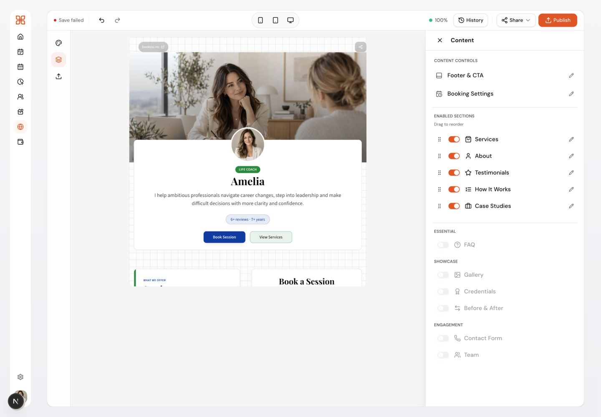

