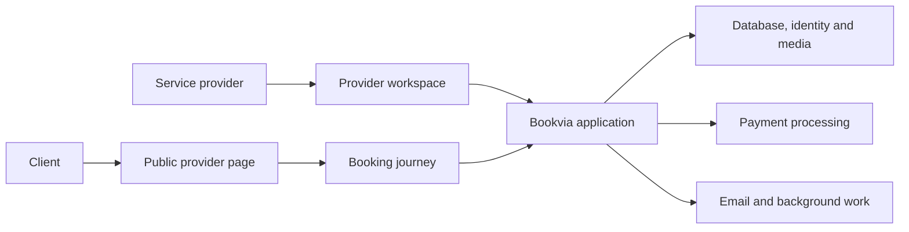

# Technical overview

Bookvia is a private-source web application. This page describes its architecture at a product level; it does not publish schemas, application code, access policies, infrastructure identifiers or deployment instructions.

## Platform structure

| Layer | Private implementation |
| --- | --- |
| Web application | Next.js App Router, React and TypeScript |
| User interface | Reusable components and provider-specific page themes |
| Data, identity and media | Supabase with Postgres, Auth and storage |
| Provider payments | Stripe Connect and booking/checkout workflows |
| Email | Resend and transactional templates |
| Background processing | Inngest |
| Monitoring | Sentry |
| Hosting direction | Vercel |

Naming a service describes implementation choices, not a certification, partner relationship or claim that every environment is configured.

## Engineering concerns

The product crosses several stateful boundaries: availability, temporary booking reservations, payment state, confirmed appointments and client access. The implementation includes validation, provider/account ownership checks, payment/webhook handling and automated tests around parts of those boundaries.

The important engineering objective is agreement across them: an available-looking time must be bookable, the displayed price must match checkout, and payment or cancellation events must leave booking and refund states consistent. Tenant isolation, retry behaviour and recovery matter as much as the visible form.

## Evidence in this repository

Fresh local captures demonstrate public profile rendering, service selection, available future slots, the empty details form and FAQ interaction. Historical onboarding and calendar component captures are labelled separately. No live payment was initiated and no booking was submitted during capture.

The private project contains unit/integration and browser tests, but those sources and logs are not published here. This showcase does not claim a current passing full-suite count, audited security, service availability, regulatory certification or independent reproduction of the platform.

## Contribution and assistance

The project combines product direction, business-process modelling, interface design and full-stack implementation. AI tools assisted implementation, debugging, tests and documentation. The showcase presents the product and its development decisions; technical proficiency is best assessed through a walkthrough of the private implementation where appropriate.
